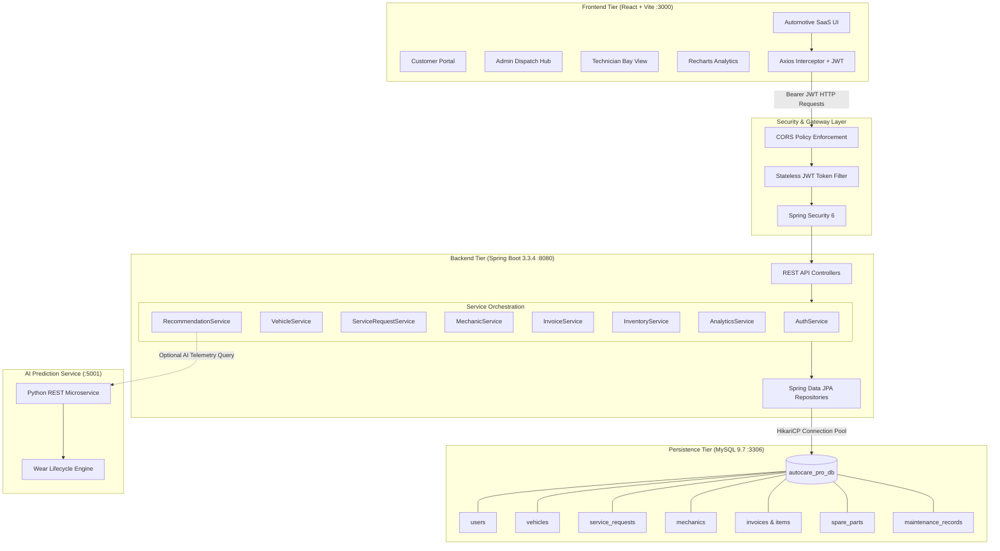

# AutoCare Pro – System Architecture

## Architectural Blueprint
AutoCare Pro is architected as an automotive SaaS application adhering to 3-tier enterprise standards:
1. **Presentation Layer**: React.js 18 with Tailwind CSS, Lucide Icons, and Recharts
2. **Application Layer**: Java 21 Spring Boot 3.3 RESTful Microservices with Spring Security & JJWT
3. **Persistence Layer**: MySQL 9.7 with Hibernate ORM & Spring Data JPA
4. **Predictive AI Layer**: Explainable Automotive Wear Intelligence Engine (Python Microservice + Embedded Java Fallback)

## Key Architectural Principles
- **Separation of Concerns**: Strict boundary between business logic (`@Service`), data abstraction (`@Repository`), and HTTP transport (`@RestController`).
- **Stateless Authorization**: JWT token claims (`sub`, `userId`, `role`, `fullName`) eliminate server-side session state and enable horizontal scaling.
- **Workflow State Machine**: Strictly validates milestone transitions (`BOOKED -> APPROVED -> ASSIGNED -> IN_PROGRESS -> COMPLETED -> DELIVERED`).
- **Transactional Consistency**: `@Transactional` ensures atomic updates when issuing inventory, billing invoices, or completing work orders.
