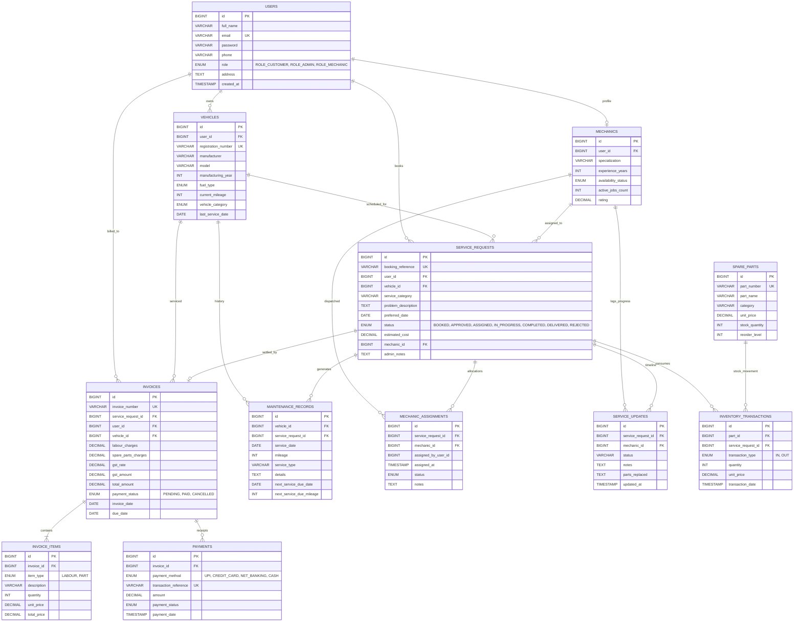

# AutoCare Pro – Entity-Relationship (ER) Diagram

## Database Specification
- **Engine**: MySQL 9.7 (InnoDB)
- **Database Name**: `autocare_pro_db`
- **Total Relational Entities**: 12 Normalized Tables
- **Constraints**: Foreign Key constraints with `CASCADE` and `SET NULL` referential integrity

